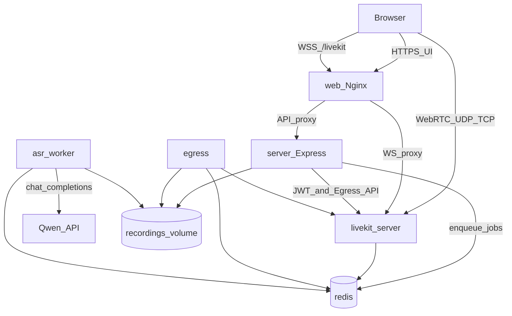

# VCLK — документация системы для RAG

Документ описывает проект **VCLK** (видеоконференц-связь / ВКС) на базе LiveKit.
Файл предназначен для загрузки в RAG: вопросы о архитектуре, сервисах, API, портах, записи, транскрибации и саммари.

Связанные файлы репозитория: `README.md` (запуск), `GLOSSARY.md` (термины UI), `FEATURE_CHECKLIST.md` (функции и тесты).

---

## 1. Краткое описание проекта

**Название:** VCLK  
**Тип:** self-hosted видеоконференции (ВКС)  
**Базовый движок медиа:** LiveKit Server  
**Репозиторий:** livekitproj  

Система позволяет:

1. Создавать/входить в комнату по коду комнаты и имени участника.
2. Обмениваться аудио/видео, демонстрацией экрана и чатом.
3. Записывать комнату на сервере в MP4 (LiveKit Egress).
4. Автоматически транскрибировать запись (faster-whisper на CPU).
5. Делать саммари транскрипта через сетевую модель Qwen.
6. Просматривать архив записей, транскрипты и саммари в защищённом UI.

**Прод-хост ВКС (пример):** `192.168.215.44`  
**Публичный домен (пример):** `https://vclk.asntl.ru`  
**Модель саммари (пример):** `Qwen/Qwen3.5-35B-A3B-FP8` на `http://192.168.215.74:9080/v1`

---

## 2. Словарь сущностей (для поиска в RAG)

| Сущность | Что это |
|----------|---------|
| VCLK | Название продукта ВКС |
| Комната ожидания | Pre-join экран до получения JWT (`token === null`) |
| Комната общения | In-room экран внутри LiveKitRoom |
| Архив записей | HTML UI `/recordings` для MP4 + транскрипт + саммари |
| JWT / Access Token | Токен входа участника в LiveKit (TTL 2 часа) |
| Egress | Сервис серверной записи комнаты (Chrome + ffmpeg) |
| ASR worker | Контейнер `asr-worker`, транскрибация Whisper |
| Очередь транскрибации | Redis list `transcription:jobs` |
| Транскрипт | Файл `{stem}.transcript.json` рядом с MP4 |
| Саммари | Краткий итог встречи от Qwen внутри transcript JSON |
| Signaling proxy | Nginx путь `/livekit` → LiveKit `:7888` |
| REC badge | Индикатор активной записи в UI комнаты |

---

## 3. Архитектура и кто с кем общается

```text
Браузер участника
  │
  ├─ HTTPS UI ──────────────► web (Nginx :8443 / :8080)
  │                              │
  │                              ├─ /token /recording /recordings /avatar /health ──► server (Express :3101)
  │                              └─ /livekit (WebSocket) ──────────────────────────► livekit (:7888)
  │
  └─ WebRTC media (UDP/TCP) ──────────────────────────────────────────────────────► livekit (:7882, :50000-50100/udp)

server
  ├─ выдаёт JWT (livekit-server-sdk)
  ├─ стартует/останавливает запись через LiveKit Egress API ──► livekit ──► egress
  ├─ пишет/читает файлы записей ──► volume /out (host: ./recordings)
  └─ ставит задачи ASR в Redis list transcription:jobs ──► redis

egress
  ├─ подписан на Redis
  ├─ подключается к LiveKit как участник-рекордер
  └─ сохраняет MP4 в /out

asr-worker
  ├─ читает задачи из Redis (BLPOP transcription:jobs)
  ├─ читает MP4 из /out
  ├─ ffmpeg → WAV → faster-whisper (CPU)
  ├─ HTTP POST саммари ──► Qwen API (внешний хост, OpenAI-compatible /v1/chat/completions)
  └─ пишет {stem}.transcript.json и {stem}.transcript.txt в /out
```

### Mermaid (для визуализации)



---

## 4. Docker-сервисы (prod)

Файл: `docker-compose.prod.yml`  
Запуск: `./deploy.sh` или `docker compose -f docker-compose.prod.yml up -d`

| Сервис | Образ / build | Назначение |
|--------|---------------|------------|
| `redis` | `redis:7-alpine` | Состояние LiveKit/Egress + очередь ASR |
| `livekit` | `livekit/livekit-server:latest` | Signaling + WebRTC медиасервер |
| `egress` | `livekit/egress:latest` | Серверная композитная запись комнаты в MP4 |
| `server` | build `./server` | Token API, запись, архив, enqueue ASR |
| `asr-worker` | build `./asr` | Транскрибация + саммари |
| `web` | build `./web` | React SPA + Nginx reverse proxy + TLS |

Общий volume записей: `${RECORDINGS_HOST_PATH:-./recordings}` → `/out` у `egress`, `server`, `asr-worker`.

---

## 5. Порты и URL

| Порт | Кто слушает | Назначение |
|------|-------------|------------|
| 8080 | web | HTTP UI (редирект на HTTPS) |
| 8443 | web | HTTPS UI + API proxy |
| 3101 | server | Внутренний Express (не публикуется наружу в prod) |
| 7888/tcp | livekit | Signaling / HTTP API |
| 7882/tcp | livekit | WebRTC TCP fallback |
| 50000–50100/udp | livekit | WebRTC media |
| 6379 | redis | Только внутри Docker-сети |

### Типовые URL

| URL | Назначение |
|-----|------------|
| `https://vclk.asntl.ru/` | Главный UI (через корпоративный reverse proxy) |
| `https://192.168.215.44:8443/` | Прямой доступ к UI на ВКС |
| `https://.../?room=demo-room&name=Alice` | Deep-link в комнату ожидания |
| `wss://.../livekit` | Signaling LiveKit через Nginx |
| `https://.../health` | Healthcheck backend |
| `https://.../recordings` | Архив записей (нужен логин) |
| `https://.../recordings/login` | Логин архива |

Корпоративный reverse proxy должен пробрасывать WebSocket для `/livekit/` и медиа-порты LiveKit до хоста ВКС.

---

## 6. Пользовательские сценарии

### 6.1. Вход в комнату

1. Пользователь открывает UI.
2. Вводит имя и код комнаты (или приходит по `?room=&name=`).
3. Опционально снимает аватар с превью камеры.
4. UI вызывает `POST /token`.
5. UI подключается к LiveKit по `wss://<host>/livekit` с JWT.
6. Публикует камеру/микрофон, подписывается на других участников.

### 6.2. Запись комнаты

1. В комнате общения меню ⚙ → «Начать запись».
2. `server` вызывает LiveKit Egress `StartRoomCompositeEgress`.
3. Egress поднимает headless Chrome, композитит комнату, пишет MP4 в `/out`.
4. «Остановить запись» → `StopEgress`.
5. Через ~2.5 с `server` ставит задачу транскрибации в Redis.

### 6.3. Транскрибация и саммари

1. `asr-worker` забирает job из Redis.
2. `ffmpeg` извлекает аудио 16 kHz mono.
3. `faster-whisper` (модель `small`, CPU, int8, язык `ru`) делает транскрипт.
4. Модель Whisper выгружается из RAM (lazy load).
5. HTTP-запрос к Qwen делает саммари.
6. Результат сохраняется в `{stem}.transcript.json` и `.txt`.
7. В архиве `/recordings` пользователь видит статус, прогресс, модалку «Транскрипт» / «Саммари».

---

## 7. Backend API (`server/index.js`)

| Метод | Путь | Описание |
|-------|------|----------|
| GET | `/health` | `{ ok: true }` |
| GET/POST | `/token` | Выдача LiveKit JWT (`room`, `username`, optional `avatarUrl`) |
| POST | `/avatar` | Загрузка аватара (data URL, до 256 KB) |
| GET | `/avatar/:id` | Отдача аватара |
| POST | `/recording/start` | Старт записи комнаты |
| POST | `/recording/stop` | Стоп записи + enqueue ASR |
| GET | `/recording/status?room=` | Статус активной записи |
| GET/POST | `/recordings/login` | Логин архива |
| GET | `/recordings/logout` | Выход |
| GET | `/recordings` | HTML архив (auth) |
| GET | `/recordings/files/*` | Статика MP4 (auth) |
| GET | `/recordings/:file/transcript` | JSON транскрипта + progress (auth) |
| POST | `/recordings/:file/transcribe` | Поставить/перезапустить ASR (auth) |
| POST | `/recordings/:file/summarize` | Пересчитать только саммари (auth) |

---

## 8. Frontend

### React SPA (`web/`)

- Стек: React 19, Vite, TypeScript, `livekit-client`, `@livekit/components-react`
- Главный файл UI: `web/src/App.tsx`
- Хелперы: `web/src/lib/meetingHelpers.ts`

**Комната ожидания:** превью камеры/микрофона, выбор устройств, индикатор сети, аватар, форма входа, ссылка-приглашение.

**Комната общения:** фокус/сетка, mobile-раскладки, mute/camera/screen share, чат, список участников, копирование ссылки, запись, выход.

### Архив записей (server-rendered HTML)

- Рендер: `server/lib/recordingsPage.js`
- Не React SPA
- Список MP4, видеоплеер, модалка транскрипта/саммари, progress bar по этапам ASR

---

## 9. Файлы данных

Каталог host: `RECORDINGS_HOST_PATH` (по умолчанию `./recordings`)  
В контейнерах: `/out`

| Файл | Описание |
|------|----------|
| `{room-slug}-{timestamp}.mp4` | Запись комнаты |
| `{stem}.transcript.json` | Статус, сегменты, текст, саммари, progress |
| `{stem}.transcript.txt` | Плоский текст транскрипта |

Пример имени: `demo-room-2026-07-09T12-30-00-000Z.mp4`

Статусы транскрипта: `missing` → `queued` → `transcribing` → `summarizing` → `done` / `error`.

Прогресс приблизительный по этапам (Whisper не отдаёт точный % по словам): очередь ~12%, транскрибация 35–75%, саммари ~85%, готово 100%.

---

## 10. Аутентификация

### Комната встречи

- Без пароля комнаты.
- Доступ по JWT LiveKit, который выдаёт `server` любому, кто знает URL/код комнаты.

### Архив записей `/recordings`

- Логин/пароль из `server/.env`: `RECORDINGS_VIEW_USER`, `RECORDINGS_VIEW_PASSWORD`
- Cookie-сессия `recordings_session` (HMAC, TTL 12 часов)
- Также поддерживается HTTP Basic Auth с теми же credentials
- Если пароль не задан — архив отвечает 503

---

## 11. Важные библиотеки и версии

### Backend (`server/package.json`)

- `express` ^5.2.1
- `livekit-server-sdk` ^2.15.4
- `redis` ^4.7.1
- `cors` ^2.8.6
- `dotenv` ^17.4.2
- `vitest` ^3.2.4 (тесты)

### Frontend (`web/package.json`)

- `react` / `react-dom` ^19.2.6
- `livekit-client` ^2.19.0
- `@livekit/components-react` ^2.9.21
- `@livekit/components-styles` ^1.2.0
- `vite` ^8.0.12
- `typescript` ~6.0.2

### ASR (`asr/requirements.txt`)

- `faster-whisper==1.1.1`
- `redis==5.2.1`
- `requests==2.32.3`
- системно в образе: `ffmpeg`, Python 3.11

### Инфраструктурные образы

- `livekit/livekit-server:latest`
- `livekit/egress:latest`
- `redis:7-alpine`
- `nginx:1.27-alpine` (в web Dockerfile)

---

## 12. Ключевые конфигурационные файлы

| Файл | Роль |
|------|------|
| `docker-compose.prod.yml` | Prod-стек всех сервисов |
| `livekit.prod.yaml` | Конфиг LiveKit (порты RTC, Redis, keys) |
| `livekit.prod.turn.yaml` | Опциональный TURN для сложных сетей |
| `egress.prod.yaml` | Конфиг Egress (ws_url, keys, Redis) |
| `.env` / `.env.prod.example` | Порты web, TLS, Whisper, Qwen |
| `server/.env` | API keys LiveKit, пароль архива |
| `web/docker-entrypoint.d/40-tls-setup.sh` | TLS cert + генерация nginx conf |
| `asr/worker.py` | Логика ASR + summary |
| `server/lib/transcription.js` | Имена артефактов, статусы, progress |
| `server/lib/recordingsPage.js` | HTML UI архива |
| `deploy.sh` | Сборка и подъём prod |

API keys LiveKit должны совпадать в `livekit.prod.yaml`, `egress.prod.yaml` и `server/.env`.

---

## 13. Переменные окружения (важные)

### Web / TLS

- `WEB_PORT=8080`
- `WEB_HTTPS_PORT=8443`
- `TLS_IP` — IP для self-signed SAN
- `PUBLIC_HOSTNAME` — например `vclk.asntl.ru`
- `TLS_CERT_DIR=./certs`

### Записи

- `RECORDINGS_HOST_PATH=./recordings`
- `RECORDINGS_VIEW_USER=viewer`
- `RECORDINGS_VIEW_PASSWORD=...`
- `RECORDINGS_SESSION_SECRET=...`

### LiveKit

- `LIVEKIT_URL=ws://livekit:7888`
- `LIVEKIT_HTTP_URL=http://livekit:7888`
- `LIVEKIT_API_KEY=devkey`
- `LIVEKIT_API_SECRET=...`
- `LIVEKIT_CONFIG_FILE=./livekit.prod.yaml`

### ASR / Summary

- `TRANSCRIPTION_ENABLED=true`
- `REDIS_URL=redis://redis:6379/0`
- `ASR_QUEUE_KEY=transcription:jobs`
- `WHISPER_MODEL=small`
- `WHISPER_DEVICE=cpu` (позже `cuda`)
- `WHISPER_COMPUTE_TYPE=int8` (на GPU обычно `float16`)
- `WHISPER_LANGUAGE=ru`
- `SUMMARY_ENABLED=true`
- `SUMMARY_API_BASE_URL=http://192.168.215.74:9080/v1`
- `SUMMARY_MODEL=Qwen/Qwen3.5-35B-A3B-FP8`
- `SUMMARY_API_KEY=` (пусто, если не требуется)
- `SUMMARY_MAX_TOKENS=512`
- `SUMMARY_TEMPERATURE=0.0`

Для Qwen3.5 thinking отключён параметрами `enable_thinking=false` и `chat_template_kwargs.enable_thinking=false`.

---

## 14. Операционные ограничения

1. **RAM:** для одновременной записи (Egress/Chrome) и ASR нужно достаточно памяти. Практично: **8–12+ GB**. На 4 GB запись часто падает с `websocket url timeout` / Chrome fail.
2. **ASR lazy load:** Whisper грузится только на задачу и выгружается после, чтобы не держать ~800+ MB постоянно.
3. **Concurrency ASR:** один job за раз (один worker loop).
4. **Первый старт asr-worker:** скачивает модель Whisper `small` с HuggingFace — несколько минут.
5. **Диаризация спикеров:** в v1 выключена (`diarization.enabled=false`, `speaker=null`).
6. **Саммари считается вне ВКС** на хосте Qwen; ВКС должен иметь сетевой доступ до `SUMMARY_API_BASE_URL`.
7. **HTTPS обязателен** для камеры/микрофона в браузере.
8. Аватары хранятся **в памяти** процесса `server` и теряются при рестарте.

---

## 15. Тесты и качество

- Unit-тесты: Vitest
- Команды из корня:
  - `npm test` — server + web helpers
  - `npm run test:release` — тесты + production build web
- Чеклист функций: `FEATURE_CHECKLIST.md`
- Глоссарий UI/сущностей: `GLOSSARY.md`

---

## 16. FAQ для RAG (типовые вопросы)

**Что такое VCLK?**  
Self-hosted ВКС на LiveKit с записью, транскрибацией Whisper и саммари через Qwen.

**Какие Docker-сервисы входят в prod?**  
`redis`, `livekit`, `egress`, `server`, `asr-worker`, `web`.

**Куда пишутся записи?**  
В каталог `RECORDINGS_HOST_PATH` (по умолчанию `./recordings`), внутри контейнеров путь `/out`.

**Как клиент подключается к LiveKit?**  
Браузер ходит на `wss://<host>/livekit`, Nginx проксирует на `livekit:7888`. Медиа идёт напрямую на порты LiveKit UDP/TCP.

**Как запускается транскрибация?**  
Автоматически после `/recording/stop` (через ~2.5 с) или вручную кнопкой в `/recordings`.

**Какая модель транскрибации?**  
`faster-whisper`, модель `small`, устройство `cpu`, `int8`, язык `ru`.

**Какая модель саммари?**  
Сетевая OpenAI-compatible модель, по умолчанию `Qwen/Qwen3.5-35B-A3B-FP8` на `http://192.168.215.74:9080/v1`.

**Где смотреть записи и транскрипты?**  
`https://<host>/recordings` после логина `RECORDINGS_VIEW_USER` / `RECORDINGS_VIEW_PASSWORD`.

**Почему запись может падать?**  
Чаще всего нехватка RAM для Chrome Egress, либо сеть/WebSocket до LiveKit. После апгрейда RAM до ~15 GB запись работает стабильнее.

**Есть ли диаризация?**  
Пока нет; заложена в JSON (`speaker`, `diarization.enabled`) для будущего GPU-этапа.

**Какой домен у системы?**  
Пример прод-домена: `vclk.asntl.ru` (прокси на `192.168.215.44:8443`).

---

## 17. Структура репозитория (важное)

```text
livekitproj/
  docker-compose.prod.yml
  livekit.prod.yaml
  egress.prod.yaml
  deploy.sh
  .env.prod.example
  README.md
  READMERAG.md          ← этот файл
  GLOSSARY.md
  FEATURE_CHECKLIST.md
  server/               ← Express API + архив записей
  web/                  ← React UI + Nginx
  asr/                  ← Python ASR worker
  recordings/           ← MP4 и transcript-артефакты (runtime)
  certs/                ← TLS сертификаты (опционально)
```

---

## 18. Правило сопровождения документа

При существенных изменениях системы обновляйте этот файл:

1. Новые сервисы / порты / API → разделы 4, 5, 7.
2. Новые пользовательские функции → разделы 6, 8 и `FEATURE_CHECKLIST.md`.
3. Новые термины → раздел 2 и `GLOSSARY.md`.
4. Смена моделей ASR/LLM → разделы 11, 13, 16.
